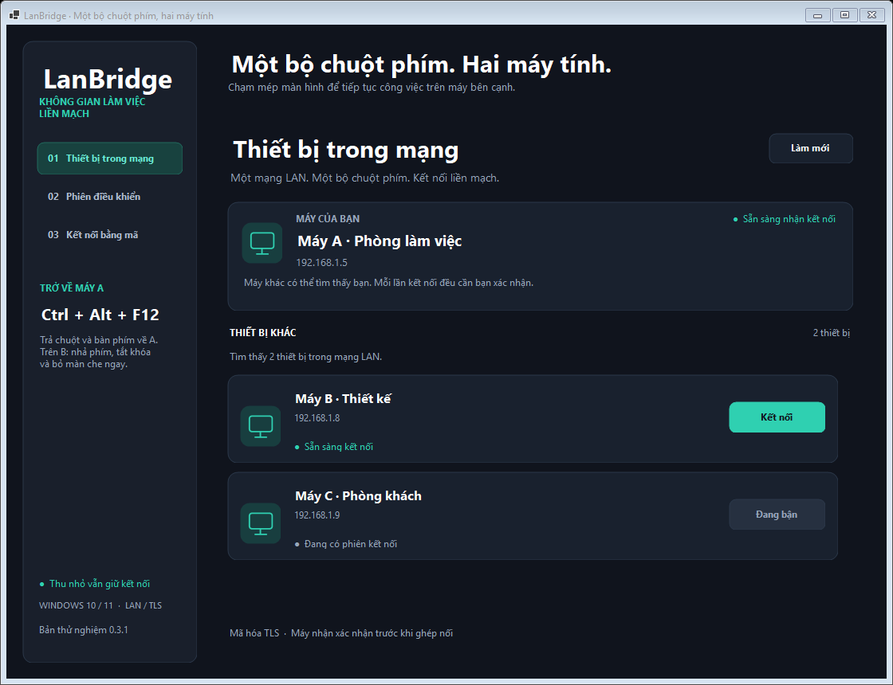

# LanBridge 0.6.1

Ứng dụng Windows cho hai máy tính chung mạng LAN: đưa chuột qua mép màn hình A để dùng chuột và bàn phím của A trên máy B. Mỗi máy tiếp tục dùng màn hình riêng. Đây là bản thử nghiệm có mã nguồn và bản chạy độc lập cho Windows 10/11 x64.

[Tải bản Windows 0.6.1](https://github.com/dtai52hz/lanbridge/releases/tag/v0.6.1): chọn **LanBridge-0.6.1-Setup-x64.exe** để cài tự động, hoặc ZIP để chạy trực tiếp. Mã nguồn công khai theo [giấy phép MIT](LICENSE); có thể tải, sửa và phân phối theo điều kiện trong giấy phép.



## Chạy trên hai máy

1. Trên **cả hai máy**, chạy bộ cài `LanBridge-0.6.1-Setup-x64.exe`, rồi mở **LanBridge** từ Start menu. Hoặc giải nén ZIP và mở `LanBridge.exe`. Không cần cài .NET riêng.
2. Ứng dụng mở trang **Thiết bị trong mạng**, tự tìm các máy cũng đang mở LanBridge 0.6.1 trong cùng mạng LAN. Nếu Windows hỏi tường lửa, cho phép ứng dụng trên mạng **Riêng tư / Private**.
3. Trên máy có chuột/bàn phím chính (**A**), tìm tên và IP của **B** rồi bấm **Kết nối** ở thẻ máy đó. Không cần chọn vai trò A/B, nhập IP hoặc chép mã trong luồng này.
4. Trên **B**, hộp **Yêu cầu kết nối** hiện tên và IP của A. Bấm **Đồng ý** để nhận điều khiển, hoặc **Từ chối**. Mỗi yêu cầu tìm qua danh sách đều cần xác nhận tại B; yêu cầu hết hạn sau 30 giây.
5. Ứng dụng chuyển sang **Phiên điều khiển**. Trên A chọn B nằm bên phải/trái/trên/dưới A và bộ gõ Telex/VNI/Phím gốc. Trên B bật/tắt quyền cần cấp.
6. Đưa chuột tới mép đã chọn: **chuyển ngay, không chờ**. Ví dụ B nằm bên phải A: chạm mép phải A để sang B; đưa chuột qua mép trái B để quay lại A.
7. **Ctrl + Alt + F12** trên A trả chuột/phím về A. Trên B, tổ hợp này còn bỏ màn che, tắt khóa đầu vào và thu hồi quyền chuột/phím. **Ngắt kết nối** kết thúc phiên và trở về danh sách thiết bị.

**Chỉ các máy đang mở LanBridge mới hiện trong danh sách.** Cài/chạy file một lần rồi đóng ứng dụng không làm máy luôn xuất hiện. Máy đã đóng/mất mạng sẽ được loại khỏi danh sách sau khoảng 7–9 giây. Ứng dụng không tự cài dịch vụ hay tự mở cùng Windows; sau khi khởi động lại B cần mở lại LanBridge.

Tên máy, cổng kết nối, trạng thái bận và dấu vân tay chứng chỉ được thông báo qua UDP trong LAN; mã ghép nối bí mật không được phát qua UDP. Máy nhận xác nhận từng yêu cầu trước khi cho phép phiên TLS. Dấu vân tay được kiểm tra theo thiết bị vừa phát hiện; danh sách LAN không phải danh bạ tài khoản đã xác minh.

## Cài đặt và gỡ cài đặt

Bộ cài EXE chép ứng dụng vào `%LOCALAPPDATA%\Programs\LanBridge`, tạo mục Start menu và mục gỡ cài đặt cho tài khoản Windows hiện tại. Có thể chọn thêm shortcut Desktop. Đóng LanBridge đang chạy trước khi cài/cập nhật; bộ cài không tự đóng phiên làm việc. Cài xong, mở LanBridge từ Start menu để kết nối hai máy.

Gỡ tại **Windows Settings → Apps → Installed apps → LanBridge → Uninstall**. Thiết lập và cache clipboard trong `%LOCALAPPDATA%\LanBridge`, file đã nhận ở Downloads và bản ghi ở Videos được giữ lại. Cài đặt không thêm dịch vụ hoặc tự mở cùng Windows.

Cài im lặng, dùng thư mục mặc định và không tự mở ứng dụng sau cài:

```powershell
Start-Process .\LanBridge-0.6.1-Setup-x64.exe -ArgumentList '/VERYSILENT', '/SUPPRESSMSGBOXES', '/NORESTART', '/SP-' -Wait
```

## Kết nối bằng mã khi cần

Nếu mạng chặn tìm thiết bị, vẫn có trang **Kết nối bằng mã**:

1. Trên B chọn **Máy B · Nhận điều khiển**, chọn IP mạng đang dùng, bấm **Bật nhận kết nối → Sao chép mã**.
2. Trên A chọn **Máy A · Chuột và bàn phím chính**, dán mã và bấm **Kết nối máy B**.
3. Mã là thông tin cấp quyền trực tiếp, chỉ gửi cho máy A bạn muốn cho kết nối. Nó có hiệu lực tới khi đóng LanBridge trên B. Luồng có mã không hiện lại hộp hỏi như luồng tìm thiết bị.

Ngắt phiên không tắt bộ tìm máy; đóng ứng dụng để máy ngừng quảng bá và nhận kết nối.

## Tiện dùng hằng ngày

Trên trang **Phiên điều khiển**, bấm vị trí B quanh hình **Máy A** để chọn mép chuyển chuột, hoặc dùng danh sách phía dưới. Khi sơ đồ được chọn, bốn phím mũi tên chọn bên tương ứng. Các thiết lập điều khiển này được thay đổi trên A.

**Tốc độ chuột trên B (%)** nhận giá trị 50–200, mặc định 100. Giảm nếu B di chuyển quá xa, tăng nếu cần rê tay nhiều. Điều chỉnh có hiệu lực trong phiên, giữ phần chuyển động nhỏ và không thay đổi thiết lập chuột của Windows hay giá trị nấc cuộn.

LanBridge tự nhớ vị trí B, Telex/VNI/Phím gốc, tốc độ chuột và tùy chọn thu nhỏ tại `%LOCALAPPDATA%\LanBridge\preferences.json`. Mở lại ứng dụng để tiếp tục dùng những lựa chọn đó. Quyền và mã ghép nối không nằm trong file này. 0.6.0 vẫn kết nối được với 0.5.4; cập nhật mỗi máy nếu muốn các tiện ích mới ở máy đó.

Dòng trạng thái trong phiên hiển thị thời gian đã kết nối và RTT TLS làm mượt. RTT này gồm xử lý của ứng dụng, không đo lúc ứng dụng B đã vẽ xong; mở **Đo độ trễ** nếu cần báo cáo chi tiết.

## Thu nhỏ và chạy ở khay hệ thống

Nút **−** chỉ thu nhỏ cửa sổ; phiên kết nối, chuột/phím và âm thanh vẫn chạy. Mở lại LanBridge từ thanh tác vụ để xem hoặc thay đổi phiên. Nút **×** đóng ứng dụng và kết thúc kết nối.

Bấm **Ẩn xuống khay** ở thanh bên để giữ ứng dụng chạy ở vùng biểu tượng gần đồng hồ Windows. Bấm đúp biểu tượng hai màn hình của LanBridge để mở lại, hoặc bấm chuột phải để **Mở LanBridge**, **Trả điều khiển / mở khóa**, **Ngắt kết nối** hay **Thoát LanBridge**. Có thể phải mở mũi tên **^** để thấy biểu tượng. Mở lại EXE 0.6.0 khi ứng dụng đã chạy cũng yêu cầu hiện cửa sổ hiện có.

Đánh dấu **Thu nhỏ xuống khay** nếu muốn nút **−** tự ẩn vào khay; tùy chọn được nhớ cho lần mở sau và mặc định tắt. Nút **×** và lệnh **Thoát LanBridge** vẫn kết thúc phiên. Khi có người yêu cầu kết nối hoặc restart, B mở lại cửa sổ để bạn xác nhận. Chạy ở khay không tự mở ứng dụng sau khi khởi động Windows.

Từ 0.3.1, chuột/phím chạy trên một luồng xử lý riêng, không chờ thao tác vẽ, kéo hoặc thu nhỏ cửa sổ. Các vị trí chuột liên tiếp được gộp khi có dữ liệu dồn, giữ vị trí mới nhất trước mỗi phím/nút/cuộn hoặc chuyển máy. Mất mạng vẫn tự nhả điều khiển. Nếu đang dùng bản cũ, đóng LanBridge rồi thay bản 0.6.1 trên cả A và B.

## Di chuyển và cuộn chuột cùng lúc

Bản 0.5.1 giảm dồn thao tác khi chuột có tần số lấy mẫu cao: gửi vị trí mới nhất theo nhịp danh nghĩa 8 ms, gộp các vị trí chưa gửi liền nhau trước khi mã hóa và dùng một lần ghi TLS cho mỗi gói. Lần di chuyển đầu tiên, chuyển mép và thao tác phím/nút/cuộn được xử lý ngay; không thêm thời gian chờ ở mép.

Trên B, các gói nhập được xử lý theo nhóm tối đa 32 gói trên luồng riêng. Mỗi nấc cuộn vẫn giữ đủ giá trị, chiều, tọa độ và thứ tự với phím/nút; không cộng dồn cuộn qua vị trí khác. Cập nhật cả A và B để dùng đầy đủ thay đổi. Độ mượt thực tế còn phụ thuộc mạng và tải máy.

Bản 0.5.2 tiếp tục sửa độ trễ khi vừa rê chuột vừa click/gõ: bỏ lệnh đưa con trỏ về giữa A lặp lại theo từng mẫu chuột. Các mẫu đó đã bị hook giữ lại nên A vẫn ở điểm giữa; chỉ cần đưa con trỏ tới đó khi chuyển sang B và đặt lại khi quay về A. Nhịp gửi vị trí dùng đồng hồ `Stopwatch` thay cho đồng hồ Windows có bước 10–16 ms; không thay đổi độ phân giải timer toàn hệ thống.

Clipboard, file, âm thanh, ghi hình và thông báo giao diện được xử lý theo thứ tự trên một hàng đợi riêng có giới hạn. Chuột/phím không còn phải chờ clipboard bận, ổ đĩa hoặc một phản hồi truyền file. Xác nhận ban đầu, quyền, bật/tắt Màn che và Khóa đầu vào vẫn giữ thứ tự trước các thao tác nhập tiếp theo. Việc thu hồi quyền và hủy phiên vẫn được kiểm tra.

Bản 0.5.4 sửa tiếp khâu nhận trên B: một worker riêng gọi `SendInput`, để luồng hook không phải chờ lời gọi Windows này. Đầu vào native của tối đa 32 gói được ghép theo thứ tự vào cùng một lời gọi, giảm việc chạy dồn khi mỗi lần gọi Windows tốn nhiều thời gian. Phím, click, chữ, nấc cuộn và ranh giới chuyển máy vẫn được giữ; thu hồi quyền nhả đầu vào sau lời gọi đang chạy. **Có thể cập nhật B trước, A 0.5.3 vẫn kết nối được.** Việc đặt con trỏ trên A khi chuyển mép vẫn xử lý ngay như trước.

## Đo khi vẫn khựng rồi chạy dồn

Bản 0.5.3 thêm số đo trong phiên để tìm khâu gây chậm trên hai máy thật. Các kết quả kiểm thử localhost ở phần dưới chỉ xác minh đường mã; việc xác định nguyên nhân trên A/B cần số đo của chính phiên đó.

1. Dùng **0.5.3 hoặc mới hơn trên cả A và B**, kết nối rồi mở **Phiên điều khiển → Đo độ trễ** trên mỗi máy.
2. Thử rê chuột, click, cuộn và gõ để tái hiện hiện tượng trong 15–20 giây. Số đo được cập nhật mỗi nửa giây.
3. Bấm **Tạm dừng số đo → Chép kết quả đo** trên cả hai máy. Bản chép chứa phiên bản, vai trò, thời gian và số lượng; không chứa nội dung phím, clipboard hoặc tọa độ. Việc đo vẫn chạy khi cửa sổ tạm dừng hiển thị.

| Số đo | Ý nghĩa |
| --- | --- |
| Phản hồi mạng/TLS | Lượt đi/về của heartbeat, gồm hàng đợi gửi và xử lý của hai tiến trình. Đây không phải ping ICMP hoặc độ trễ riêng của Wi-Fi. |
| Đường nhập A → B → A | Mẫu trên gói input từ A tới khi B đi qua luồng nhập rồi gửi biên nhận về A. Không cần đồng bộ đồng hồ A/B. Có ở A khi đang thao tác; khoảng 2 mẫu/giây. |
| Chờ gửi trên máy này | Thời gian trong hàng đợi gửi của InputRouter trước khi gọi transport; hữu ích trên A. |
| Chờ luồng nhập Windows | Thời gian từ khi đăng tác vụ tới lúc luồng nhập riêng nhận tác vụ; hữu ích trên B. |
| Hàng đợi phiên trước luồng nhập | Số gói và dung lượng đang chờ bộ nhận xử lý; bổ sung từ 0.5.4 để thấy tồn đọng trong lúc một lời gọi Windows còn chạy. |
| Gửi đầu vào tới Windows | Thời gian gọi SendInput. Lệnh này đưa sự kiện vào hàng đợi; số nhỏ chưa chứng minh Windows hoặc ứng dụng B đã xử lý xong. |
| Callback hook / tuổi sự kiện | Thời gian callback gồm phần chuyển tới hook khác, tuổi sự kiện vật lý và tuổi input mang dấu LanBridge. Tuổi sự kiện dùng đồng hồ Windows có bước thô; chú ý các lần tăng lớn, số mẫu và tuổi mẫu. |

Các mục có gần nhất/trung bình/cực đại, số lần từ 50 ms và số mẫu. Số mẫu gửi đầu vào đếm lời gọi Windows, một lời gọi có thể chứa nhiều sự kiện. Cực đại input tính từ lúc mở ứng dụng, cực đại RTT từ lúc nối phiên; mẫu cũ được ghi rõ để tránh nhầm với lần khựng hiện tại. Biên nhận chỉ xác nhận hoàn tất lời gọi native, chưa đo lúc ứng dụng B vẽ xong. Mẫu move bị gộp giữ mã đo trên vị trí mới nhất; thiếu biên nhận của một mẫu không được coi là mất thao tác.

## Ctrl+C / Ctrl+V file giữa hai máy

1. Dùng **LanBridge 0.6.1 trên cả A và B**, kết nối như thường. Trên B bật cả **Clipboard chữ/ảnh/file** và **Truyền file**.
2. Trên B, mở File Explorer, chọn một hoặc nhiều file/thư mục rồi nhấn **Ctrl+C**. Có thể làm khi đang điều khiển B bằng chuột/phím của A.
3. LanBridge tự truyền bản sao qua phiên TLS, kiểm tra đủ dữ liệu và SHA-256. Nhật ký hiện **Clipboard đã sẵn sàng** khi toàn bộ lựa chọn đã nhận xong.
4. Chuyển chuột về A, mở thư mục đích trong File Explorer rồi **Ctrl+V**. Không cần mở hộp **Gửi file**. Chiều A → B dùng cùng cách.

File được truyền ngay khi sao chép, trước lúc dán. **File lớn cần chờ nhận xong rồi mới Ctrl+V**; nhấn dán trong lúc đang truyền chưa tạo được file ở thư mục đích. Giữ nguyên tên file, cây thư mục và thư mục trống. Hỗ trợ tối đa 2 GB/file, 8 GB/lần, 10.000 mục, 64 cấp thư mục; không sao chép symlink/junction, mục gốc trùng tên hoặc đường dẫn đặc biệt của Windows.

Bản nhận nằm trong bộ nhớ đệm riêng `%LOCALAPPDATA%\LanBridge\Clipboard`; Ctrl+V để File Explorer chép vào nơi bạn chọn. Bộ nhớ đệm đã nhận đủ được giữ khi ngắt kết nối/đóng ứng dụng để clipboard còn dùng được, và dọn các lô cũ hơn 30 ngày khi mở phiên mới. Lô chưa hoàn tất bị hủy khi mất mạng, thu hồi quyền hoặc sao chép nội dung mới. File nguồn không bị xóa; đây là sao chép, không phải Ctrl+X/di chuyển. File ảo từ ứng dụng như Outlook chưa được hỗ trợ.

## Dùng chung ảnh chụp màn hình

1. Cập nhật **LanBridge 0.6.1 trên cả A và B**, kết nối và bật **Clipboard chữ/ảnh/file** trên B. Chia sẻ ảnh không cần bật quyền Truyền file.
2. Trên B nhấn **Win+Shift+S** và chọn vùng chụp, hoặc dùng **Print Screen** theo cài đặt Windows. Công cụ chụp cần đưa ảnh vào clipboard.
3. Chờ báo **Ảnh chụp đã sẵn sàng**, chuyển về A và **Ctrl+V** trong Paint, Word hoặc ứng dụng chat hỗ trợ dán ảnh. Chiều A → B dùng cùng cách.

Ảnh được chuyển dưới dạng PNG rồi đặt vào clipboard của Windows như một ảnh; không cần lưu ảnh ra file hoặc bấm Gửi file. Ảnh lớn được truyền từng phần, tối đa 32 MiB PNG, 16.384 pixel mỗi chiều và tổng 40 triệu pixel. Bản nhận chỉ được đưa vào clipboard sau khi đủ dữ liệu, đúng SHA-256 và PNG hợp lệ. Nếu sao chép chữ/file/ảnh mới, tác vụ cũ được hủy và không ghi đè nội dung mới.

Ảnh trong clipboard dùng để dán vào ứng dụng hỗ trợ ảnh. File Explorer không tự lưu clipboard ảnh thành file PNG; muốn lưu thành file có thể dán vào Paint rồi lưu. Chức năng này chia sẻ ảnh bạn đã chụp, không tự chụp màn hình B liên tục.

## Gõ tiếng Việt

Trên A, trang **Phiên điều khiển** có ô **Gõ** cạnh vị trí màn hình B:

- **Tiếng Việt Telex** (mặc định): `tieengs Vieetj` → `tiếng Việt`, `ddieeuf khieenr` → `điều khiển`. Các phím dấu `s/f/r/x/j`, `aa/aw/ee/oo/ow/uw/dd` được xử lý ngay trong LanBridge.
- **Tiếng Việt VNI**: `tie6ng1 Vie6t5` → `tiếng Việt`.
- **Phím gốc**: gửi nguyên phím, phù hợp khi gõ mã, mật khẩu hoặc muốn dùng bộ gõ được cấu hình riêng trên B.

Bộ gõ Telex/VNI tích hợp gửi chữ Unicode có dấu trực tiếp, không phụ thuộc clipboard và không cần UniKey/EVKey trên B. Nếu UniKey/EVKey đang can thiệp và chữ bị sai/lặp, chuyển bộ gõ ngoài sang **E** hoặc tắt nó trong lúc thử chế độ tích hợp, nhất là khi vừa mở lại bộ gõ ngoài sau LanBridge. Chế độ tích hợp là bộ gõ cơ bản, chưa có từ điển, tự sửa chính tả hay viết tắt của UniKey.

Ctrl/Alt/Windows và phím điều hướng tiếp tục chuyển theo dạng phím; Shift chọn vùng và Shift+click được giữ. Bấm chuột, chuyển con trỏ văn bản hoặc dùng tổ hợp phím sẽ kết thúc từ đang ghép dấu để tránh sửa nhầm vị trí mới. Backspace xóa ký tự đang hiển thị.

## Quyền và chức năng

Các ô quyền ở trang **Phiên điều khiển** được thay đổi **trên máy B** và có hiệu lực trong phiên. Trên A, các ô này hiển thị quyền B đã cấp; các nút bên dưới thực hiện chức năng tương ứng. Quyền cấp cục bộ được giữ riêng với quyền mà máy khác cấp cho mình.

| Chức năng | Hành vi của bản này |
| --- | --- |
| Chuột / bàn phím | Chuyển ngay qua mép đã chọn; chuột 5 nút, cuộn dọc/ngang, phím và phím mở rộng. Telex/VNI tích hợp hoặc phím gốc. Hỗ trợ tọa độ của nhiều màn hình. |
| Clipboard chữ/ảnh/file | Văn bản hai chiều, tối đa 262.144 ký tự; ảnh chụp/bitmap qua PNG tối đa 32 MiB chỉ cần quyền Clipboard. Ctrl+C file/thư mục trong File Explorer rồi Ctrl+V ở máy kia sau khi nhận xong cần đồng thời quyền Truyền file. Chưa đồng bộ xóa clipboard tùy ý. |
| Âm thanh B | Nút **Nghe B** trên A phát âm thanh hệ thống của B. Không thu microphone; dùng PCM 48 kHz stereo. |
| Truyền file | Nút **Gửi file** trên A hoặc B; tối đa 2 GB/file. Nhận vào `%USERPROFILE%\Downloads\LanBridge`, tên mới không ghi đè. Kiểm tra số byte và SHA-256 trước khi hoàn tất. Không tự mở file nhận được. |
| Khởi động lại B | B phải cấp quyền; A yêu cầu và B xác nhận tại máy. Windows đếm 30 giây; có thể hủy bằng `shutdown /a` trên B. |
| Ghi màn hình B | A bật/tắt; ghi trên B vào `%USERPROFILE%\Videos\LanBridge`. AVI/MJPEG khoảng 8 fps, chiều ngang tối đa 1280 px, không kèm âm thanh, giới hạn 2 GB mỗi bản ghi. |
| Khóa đầu vào B | Trong lúc A điều khiển, bỏ qua chuột/phím vật lý trên B; đầu vào từ A tiếp tục hoạt động. `Ctrl+Alt+F12` vật lý trên B vẫn trả điều khiển. |
| Màn che B | Màn che đen phần mềm trên các màn hình B; cho thao tác chuột xuyên qua và vẫn có dòng chỉ dẫn thoát. Bật màn che sẽ dừng ghi hình. Đây không phải driver tắt màn hình hay chế độ riêng tư tương đương AnyDesk. |
| Chat | Tin nhắn văn bản hai chiều trong phiên. Nhật ký chỉ ở bộ nhớ ứng dụng. |

Chuột/phím, clipboard chữ và truyền file được cho phép mặc định trên B. Các quyền còn lại mặc định tắt. Khi mất kết nối, ứng dụng nhả các phím/nút nó đã giữ, bỏ khóa đầu vào và màn che, dừng âm thanh và hoàn tất bản ghi đang mở.

## Nếu không kết nối được

- Mở LanBridge 0.6.1 trên cả hai máy cùng mạng rồi bấm **Làm mới**. Wi-Fi khách hoặc tính năng AP/client isolation có thể chặn liên lạc giữa máy; danh sách không phát hiện máy ở VLAN khác hoặc chỉ có bản cũ.
- Nếu Windows Defender Firewall hỏi, cho phép LanBridge trên **mạng Riêng tư / Private** ở cả hai máy. Tìm thiết bị dùng **UDP 45832**; phiên dùng **TCP 45831** mặc định. Nếu TCP cổng đó đang bận, ứng dụng chọn một cổng trống và thông báo cổng thực qua danh sách. Cho phép theo file ứng dụng giúp áp dụng đúng cổng. Không cần mở cổng router hoặc dùng máy chủ Internet.
- Nếu đã chặn trước đó, cho phép `LanBridge.exe` tại Windows Security → Firewall & network protection → Allow an app through firewall. Ứng dụng không tự sửa tường lửa.
- Nếu máy hiện nhưng không kết nối được, kiểm tra B đang thấy yêu cầu và bấm Đồng ý trước khi hết 30 giây. Máy đang bận không nhận thêm phiên.
- Nếu vẫn không thấy máy, dùng **Kết nối bằng mã**, chọn đúng IP LAN của B, tránh IP VPN/adapter ảo. Khi đổi IP hoặc mở lại LanBridge, lấy lại mã từ B.
- Không điều khiển được cửa sổ nâng quyền: Windows giới hạn `SendInput` theo mức quyền. Chạy ứng dụng B ở cùng mức quyền với cửa sổ cần thao tác. Bản này không điều khiển màn hình UAC bảo mật, màn hình đăng nhập/khóa hay gửi Ctrl+Alt+Del. Khóa phiên Windows sẽ trả điều khiển.

## Trạng thái kiểm chứng

Đã kiểm tra tự động discovery UDP ở loopback, query/trả lời, danh sách/trạng thái bận/hết hạn, xác nhận TLS, từ chối/timeout/hủy yêu cầu, cùng các kiểm tra TLS cũ, Unicode, file, quyền và kết nối lại. Các kiểm tra giao diện dùng form ẩn/preview, không cài hook hay phát sinh thao tác nhập trên desktop. AVI từ hình tổng hợp đã được FFmpeg giải mã và tua kiểm chứng.

Kiểm tra hồi quy 0.3.1 tái hiện việc ngắt phiên trước bản sửa: hai form ẩn được thu nhỏ, luồng giao diện cố ý tạm dừng trong khi gửi hơn 2.000 gói chuột kèm phím, chữ tiếng Việt và nút chuột qua TLS thật. Sau bản sửa, luồng nhập vẫn xử lý tới gói trả điều khiển khi giao diện còn dừng; phiên và thứ tự các thao tác quan trọng được giữ. Chế độ kiểm tra dùng luồng nhập riêng nhưng tắt hook và `SendInput` thật.

Clipboard file 0.4.0 được kiểm tra cả ở bộ truyền và hai MainForm ẩn qua TLS thật: nhiều file/thư mục tiếng Việt, thư mục rỗng, SHA-256, không gửi vòng lặp, hủy lô dang dở, clipboard bận và nội dung sao chép mới, thu hồi quyền, reconnect và bản cũ không hỗ trợ. Các kiểm tra dùng clipboard giả riêng cho từng form, không thay clipboard đang dùng trên máy. Thao tác dán thật trong File Explorer trên hai PC vẫn cần thử thủ công.

Clipboard ảnh 0.5.0 được kiểm tra bằng ảnh tổng hợp: mã hóa/giải mã pixel và alpha, PNG lớn hơn một gói mạng, giới hạn 8K/40 MP, dữ liệu lỗi và giới hạn giải nén. Kiểm tra hai form ẩn qua TLS thật dùng clipboard giả để xác minh ảnh hai chiều, quyền, không echo, thử lại khi bận và hủy theo nội dung mới. Chưa kiểm chứng Snipping Tool/Print Screen và dán ảnh vào ứng dụng trên hai PC vật lý.

Hồi quy chuột/cuộn 0.5.1 dùng hai form ẩn, TLS loopback và chủ động tạm dừng luồng gửi/nhận để tạo tồn đọng: 1.000 hoặc 8.000 mẫu chuột, 32 lần cuộn cùng phím, kéo chuột và chữ còn 73 gói, xử lý qua 9 lần chuyển sang luồng nhập, giữ đủ thứ tự và tọa độ thao tác. Cùng kịch bản với mã 0.5.0 tạo 1.041 gói rồi ngắt phiên do quá tải. Đây là dữ liệu tổng hợp, tắt hook và `SendInput`; chưa đo độ trễ khi vừa di chuyển vừa cuộn trên hai PC thật.

Kiểm tra tương tác 0.5.2 gửi liên tục move/click/phím qua TLS trong lúc giao diện nhận bị tạm dừng và có gói clipboard đứng trước, hoặc bộ nhận file đang chờ ổ đĩa. Mã 0.5.1 tái hiện việc chuột/phím chờ giao diện; bản sửa xử lý tới gói trả điều khiển khi giao diện còn dừng. Kiểm tra phương thức xử lý chuột của InputRouter với 8.000 mẫu giả lập xen click/phím/cuộn xác minh không yêu cầu lệnh native dư và giữ đủ delta/tọa độ. Các kiểm tra này không cài hook, không gọi SendInput thật và không thay clipboard của người dùng.

Số đo 0.5.3 được kiểm tra bằng TLS localhost có relay trễ, peer cũ, nonce sai/lặp, gộp move giữ mã đo và tác vụ input bị giữ 120 ms. Các bộ đếm phân biệt chờ gửi, chờ luồng nhập và lời gọi native giả bị giữ; có kiểm tra dấu thời gian DWORD vòng 49,7 ngày. Báo cáo từ B sau đó cho thấy phản hồi mạng 1,3 ms nhưng lời gọi đưa đầu vào vào Windows trung bình 35,6 ms, cực đại 316,5 ms. Dữ liệu xác định khâu chậm nằm trong lời gọi native; chưa xác định thành phần Windows hoặc hook nào gây ra nó.

Hồi quy 0.5.4 dùng hai form ẩn/TLS thật, thay lời gọi native bằng observer chậm 35 ms: trong một lần đối chiếu, tuổi vị trí cuối giảm từ khoảng 1.240 ms trên mã cũ xuống 84 ms, số lời gọi giảm từ 47 xuống 19. Khi native bị giữ, luồng hook vẫn phản hồi; ACK phải chờ native, thu hồi quyền không được ACK thành công cho công việc cũ, và cấp lại quyền phải tiếp tục nhận input. Đây là tải tổng hợp, không cài hook hay tạo đầu vào thật; độ mượt sau bản sửa cần đo lại trên B.

Tiện ích 0.6.0 được kiểm tra bằng thiết lập trong thư mục tạm, biểu mẫu ẩn và TLS loopback: thay đổi liên tục vẫn lưu trạng thái cuối, cấu hình hỏng dùng mặc định, sơ đồ và tốc độ phản ánh đúng vào bộ điều khiển, ẩn hai cửa sổ vẫn truyền chuột/phím/chat/clipboard giả/file. Các kiểm tra không tạo biểu tượng khay thật hay cài hook trên desktop. Cần thử biểu tượng khay, khôi phục bằng EXE và hộp xác nhận trên Windows thực tế.

**Chưa kiểm chứng trên hai PC thật:** broadcast/multicast qua router/tường lửa thực tế, chuyển mép với chuột thực, gõ vào từng ứng dụng trên B, nhiều màn hình/DPI, âm thanh WASAPI, ghi desktop và màn che. Kiểm tra loopback không thay thế việc thử mạng Wi-Fi/Ethernet A/B của bạn.

Con trỏ trên A hiện tại vẫn hiển thị ở điểm căn giữa khi đang điều khiển B. Bản này không có cửa sổ xem trực tiếp màn hình B trên A, kéo thả file giữa hai desktop, mã hóa video thời gian thực, tự kết nối sau reboot hoặc điều khiển game dùng raw input.

## Phát triển và đóng gói

Stack: C# / .NET 10 Windows Forms, Windows hooks + `SendInput`, UDP broadcast/multicast, TLS với certificate pinning, NAudio 2.2.1. Một phiên A/B mỗi máy; không relay. Device ID ngẫu nhiên lưu trong `%LOCALAPPDATA%\LanBridge\device-id.txt`; mã ghép nối không ghi vào log hoặc file cấu hình.

Cài [.NET 10 SDK](https://dotnet.microsoft.com/en-us/download/dotnet/10.0) nếu máy phát triển chưa có. Máy hiện tại cũng có SDK cục bộ trong `.tools/dotnet`; thư mục đó không nằm trong gói mã nguồn.

```powershell
pwsh -File .\scripts\build.ps1 -Task Build
pwsh -File .\scripts\build.ps1 -Task Test
pwsh -File .\scripts\build.ps1 -Task Publish
pwsh -File .\scripts\setup-installer-tools.ps1
pwsh -File .\scripts\build.ps1 -Task Installer
```

`Publish` tạo bản chạy độc lập và ZIP; `Installer` xuất bản rồi tạo bộ cài EXE cùng file SHA-256 cho cả ZIP/EXE. Script chuẩn bị compiler tải [Inno Setup 6.7.4 chính thức](https://github.com/jrsoftware/issrc/releases/tag/is-6_7_4), kiểm tra SHA-256 và chữ ký nhà phát hành, rồi đặt bản portable trong `.tools`. Có thể gọi `scripts/build-installer.ps1 -CompilerPath C:\duong-dan\ISCC.exe` sau khi đã Publish. Script Inno Setup nằm ở `installer/LanBridge.iss`.

Hoặc chạy `dotnet run --project src/LanBridge.csproj`. Bản phát hành ở `release/LanBridge-0.6.1-win-x64/LanBridge.exe`; bản này chưa được ký chứng chỉ phát hành.

`dotnet run --project src/LanBridge.csproj -- --preview` chỉ mở giao diện, không bật hook hay lắng nghe cổng. Có thể thêm `--preview-output C:\duong-dan\preview.png` để xuất hình rồi tự đóng.

Thêm `--preview-session` để chụp trang phiên, `--preview-minimum` để dùng kích thước nhỏ nhất hoặc `--preview-latency` để chụp bảng số đo. Preview không đọc/ghi thiết lập của người dùng hay tạo biểu tượng khay. Biểu tượng ứng dụng có nguồn SVG trong `src/assets`; tạo lại ICO bằng `pwsh -File scripts/generate-icon.ps1`.

Mã nguồn: `DevicesPage.cs` danh sách thiết bị, `Discovery.cs` UDP, `MainForm.Discovery.cs` luồng tìm/kết nối/xác nhận; `MainForm.cs` phiên điều khiển, `NativeInput.cs` đầu vào, `VietnameseInput.cs` bộ gõ, `Transport.cs` TLS/heartbeat, `FileTransfer.cs` truyền file, `MediaServices.cs` media. Chi tiết kiểm thử ở [TESTING.md](TESTING.md).

## Mã nguồn mở

LanBridge được phát hành theo MIT; xem [LICENSE](LICENSE). Giữ thông báo bản quyền và giấy phép khi phân phối lại. Thành phần bên thứ ba có giấy phép riêng trong [THIRD-PARTY-NOTICES.md](THIRD-PARTY-NOTICES.md) và thư mục `licenses`. Có thể báo lỗi hoặc gửi thay đổi tại [GitHub](https://github.com/dtai52hz/lanbridge).

API Windows: [low-level hooks](https://learn.microsoft.com/en-us/windows/win32/api/winuser/nf-winuser-setwindowshookexw), [SendInput](https://learn.microsoft.com/en-us/windows/win32/api/winuser/nf-winuser-sendinput), [TLS/SslStream](https://learn.microsoft.com/en-us/dotnet/api/system.net.security.sslstream), [layered windows](https://learn.microsoft.com/en-us/windows/win32/winmsg/window-features#layered-windows).
